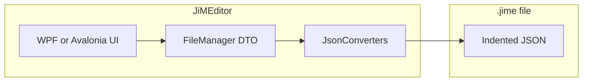

# JiMEditor WPF to Avalonia migration analysis

This document was copied from the Cursor plan store into this directory for the **JiMEditor-Avalonia** effort. Paths below refer to the sibling WPF repo **[../JiMEditor](../JiMEditor)** unless noted.

## Master branch — WPF cleanup (done / recommended)

Investigation on **master** in `../JiMEditor` showed:

- **Remaining WinForms usage to remove (recommended):**
  - [RichTextBoxIconEditor.xaml.cs](../JiMEditor/UserControls/RichTextBoxIconEditor.xaml.cs) — replace `System.Windows.Forms.MessageBox` with **WPF** `System.Windows.MessageBox` in error paths.
  - [ImageEditorWindow.xaml.cs](../JiMEditor/Views/ImageEditorWindow.xaml.cs) — replace WinForms `OpenFileDialog` with **Microsoft.Win32.OpenFileDialog** and `ShowDialog() == true`.
  - [TileEditorWindow.xaml](../JiMEditor/Views/TileEditorWindow.xaml) — remove unused `xmlns:forms=...System.Windows.Forms` if nothing references `forms:`.
- **`JiMETextFormat` helper (recommended):** Add `Common/JiMETextFormat.cs` with:
  - `CreateFlowDocumentFromSimpleHtml(...)` — logic moved out of `RichTextBoxIconEditor` so the **pseudo-HTML ↔ FlowDocument** contract lives in one place.
  - `FlowDocumentToSimpleHtml(FlowDocument)` — serialization pipeline currently inside `GetRichTextBoxSimpleHtml`.
  - **Why:** Models ([TranslationItem](../JiMEditor/Models/TranslationItem.cs), [MonsterActivationItem](../JiMEditor/Models/MonsterActivationItem.cs), [PersistentTokenInteraction](../JiMEditor/Models/Interaction%20Events/PersistentTokenInteraction.cs), plus views) should call `JiMETextFormat` instead of `RichTextBoxIconEditor.CreateFlowDocumentFromSimpleHtml`, decoupling domain from a `UserControl`. Keep an optional thin static forwarder on `RichTextBoxIconEditor` for compatibility.
- **FlowDocument on master:** Keeping **WPF `FlowDocument`** for preview/edit on Windows is correct. Centralizing conversion in `JiMETextFormat` does **not** remove `FlowDocument`; it documents the **string contract** (what goes in `.jime`) so an Avalonia UI can reimplement rendering/editing against the same strings later.

## Project index (what lives in [../JiMEditor](../JiMEditor))

| Area | Notes |
|------|--------|
| **Project** | Single SDK-style project [JiME.Core.csproj](../JiMEditor/JiME.Core.csproj): `netcoreapp3.0`, `UseWPF`, `Newtonsoft.Json` 12.0.2. **Note:** Code references **GraphX** (`http://schemas.panthernet.ru/graphx/`) but the checked-in `.csproj` may not list that package; confirm local NuGet restore or fix references before any migration baseline. |
| **XAML** | ~48 `.xaml` files: [MainWindow.xaml](../JiMEditor/MainWindow.xaml), [ProjectWindow.xaml](../JiMEditor/ProjectWindow.xaml), many editors under `Views/` and `Views/Interactions/`, plus [UserControls/](../JiMEditor/UserControls). |
| **Models / logic** | `Models/`, `Common/` (serialization, import/export), `Views/Visualization/` (graph). Large surface but largely **UI-agnostic** except where types tie to WPF (`FlowDocument`, `BitmapImage`, etc.). |

## `.jime` file format (actual definition today)

- **On disk:** JSON with **indented** formatting (`JsonConvert.SerializeObject(..., Formatting.Indented)` in [FileManager.Save](../JiMEditor/Common/FileManager.cs)).
- **Root DTO:** [FileManager](../JiMEditor/Common/FileManager.cs) — includes `fileVersion` (from [Utils.formatVersion](../JiMEditor/Common/Common.cs), currently `"1.40"`), GUIDs, lists of interactions, triggers, objectives, chapters, etc.
- **Polymorphism:** Custom `JsonConverter` types (e.g. [InteractionListConverter](../JiMEditor/Common/InteractionListConverter.cs) discriminates on `interactionType` integer). Other converters: tiles, collections, activations, monster modifiers, etc.
- **Rich text in JSON:** Strings use a **custom pseudo-HTML** (see **Master branch** § `JiMETextFormat`): `<font="Icon">…`, `<b>`, `<i>`, paragraph breaks as `\r\n\r\n`, with icon runs mapped to a font named **LoTR JiME Icons**.

This is enough to treat **“.jime = JSON schema + semantic rules + string micro-format for text fields”** rather than an opaque binary.

## UI / API migration matrix

**Likely straightforward in Avalonia (with mechanical XAML + code changes)**

- Standard windows, grids, stacks, lists, buttons, images, menus, `CommandBinding`-style patterns → Avalonia commands / interactions.
- `Microsoft.Win32` `OpenFileDialog` / `SaveFileDialog` → `Avalonia.Platform.Storage` APIs (or community file dialogs).
- `MessageBox` → `MessageBox` / window-hosted dialogs in Avalonia.
- `ObservableCollection`, MVVM-style bindings (if any expand) — same BCL patterns.
- Embedded JSON assets (`tiles.json`, `hextiles.json`) — unchanged; load as `Stream` from resources.

**High effort or replacement required**

| Piece | WPF / Windows today | Avalonia direction |
|--------|---------------------|-------------------|
| **Rich text + icons** | WPF `RichTextBox`, `FlowDocument`, `XamlWriter` / `XamlReader` in [RichTextBoxIconEditor.xaml.cs](../JiMEditor/UserControls/RichTextBoxIconEditor.xaml.cs) (or factored **JiMETextFormat**) | No `FlowDocument`. Options: **AvaloniaEdit** with custom highlighting, a **web-based** editor (embedded WebView where available), or a **custom `TextBlock`/`Inline` model** that edits the pseudo-HTML string directly. Must preserve the **exact** string rules the game expects. |
| **Read-only rich previews** | Models expose `FlowDocument` ([TranslationItem](../JiMEditor/Models/TranslationItem.cs), [MonsterActivationItem](../JiMEditor/Models/MonsterActivationItem.cs), [PersistentTokenInteraction](../JiMEditor/Models/Interaction%20Events/PersistentTokenInteraction.cs)) | Replace with Avalonia visual tree, or a small **shared parser** from pseudo-HTML → inlines (no WPF types in core models). Prefer driving previews from **`JiMETextFormat` + strings** after refactor. |
| **Graph visualization** | **GraphX** WPF controls in [GraphWindow.xaml](../JiMEditor/Views/Visualization/GraphWindow.xaml) and embedded zoom in [MainWindow.xaml](../JiMEditor/MainWindow.xaml) | GraphX is WPF-centric. Plan B: **reimplement** with Avalonia `Canvas`/Skia, or a graph library that supports Avalonia; keep graph data logic, swap only the view layer. |
| **Window chrome hack** | P/Invoke `user32` in [WindowExtensions](../JiMEditor/Common/Common.cs) | Use Avalonia `ExtendClientArea*` / platform-specific window APIs; drop `DllImport` for cross-platform. |
| **Images / fonts** | `pack://application:,,,/JiME;component/...` and `BitmapImage` in [Common.cs](../JiMEditor/Common/Common.cs) | `avares://` URIs + `Bitmap` / `IImage` APIs; verify **embedded icon font** on macOS/Linux. |
| **XAML namespace churn** | `xmlns` URIs, `clr-namespace` | Global find-replace to Avalonia namespaces; `UserControl` → `UserControl`, but property names and styling differ (`Margin`, themes, `Styles`). |

**Dependency / TFM**

- Move from `netcoreapp3.0` to a **supported LTS** (`net8.0` or `net10.0`) as part of the port.
- Consider **System.Text.Json** long-term; not required for first Avalonia build if Newtonsoft stays.

## Recommended migration phases

1. **Baseline:** Ensure the WPF project builds and list all NuGet packages (especially GraphX). Add a **golden-file** test harness: load sample `.jime` from [YourJourneyScenarios](https://github.com/TrnsltLife/YourJourneyScenarios) or fixtures, deserialize, reserialize, compare.
2. **WPF hygiene (master):** Apply **Master branch — WPF cleanup** (JiMETextFormat, Win32 dialogs, no WinForms MessageBox) so the WPF codebase is a clean baseline before Avalonia work.
3. **Split layers (optional but valuable):** Extract **serialization + models** into a **netstandard2.0 / net8.0 class library** with zero WPF references; replace `FlowDocument` properties with `string` + optional UI-specific adapters. This library becomes the home for **format validation**; **JiMETextFormat** string rules could move to a netstandard-safe “parse spec” module if you split string-only transforms from `XamlReader`/`FlowDocument`.
4. **Avalonia shell:** New Avalonia project referencing the core library; port `App`, `MainWindow`, then windows in order of dependency (project picker → scenario → editors).
5. **Rich text:** Implement one cross-platform editor that reads/writes the **same pseudo-HTML** as today; add unit tests for round-trip of tricky samples (icons + bold + italic + newlines).
6. **Graph:** Rebuild visualization or temporarily hide feature behind a flag until a Skia/canvas solution exists.
7. **Platform QA:** File paths currently assume `Environment.SpecialFolder.MyDocuments` + `"Your Journey"` — validate Linux/macOS locations and permissions.
8. **Mac executable MVP** (see below): remove residual WPF so `net9.0` + `osx-arm64` publish works.

## Mac executable MVP (strip WPF, don’t rebuild editors)

**Status (2026-08-09):** Steps 1–7 done — solution builds on `net9.0` with no WPF/Win32 dialog deps. Remaining MVP: step 8 Mac publish + smoke test. Sibling [JiMEditor](../JiMEditor) asset links remain required on both platforms. Build notes: [README-WIN.md](README-WIN.md), [README-MAC.md](README-MAC.md).

**Strategy:** Strip unused WPF model visuals and dialog APIs. Tile/Token **editors already draw with Avalonia**; model ctors still construct WPF `Canvas`/`Shape`/`BitmapImage` that the UI ignores. Do **not** reimplement WPF geometry inside models.

| Step | Work | Effort |
|------|------|--------|
| 1 | Flip TFM to `net9.0`, remove `UseWpf`; update tests TFM + `.vscode/launch.json` | **Done** (2026-08-09) |
| 2 | Delete/exclude dead WPF: `Commands.cs`, `JiME/Common/Converters.cs`, legacy `Tile.cs`, `WindowExtensions` / WPF `HandleWindow` | **Done** (2026-08-09) |
| 3 | Strip WPF visuals from `BaseTile` / `HexTile` / `SquareTile` / `Token`; keep data; prefer skip-build ctors | **Done** (2026-08-09) |
| 4 | Portable `Vector2` (`X`/`Y`) replacing `System.Windows.Vector`/`Point`; update round-trip tests | **Done** (with step 3) |
| 5 | Stop WPF preload in `Utils.Init` (`BitmapImage` / `ImageBrush`); gallery needs IDs/count only | **Done** (with step 3) |
| 6 | Dialog helper → replace ~25 `System.Windows.MessageBox` sites | **Done** (2026-08-09) |
| 7 | Win32 Open/Save → `StorageProvider` (`FileManager`, Import/Export, Campaign add) | **Done** (2026-08-09) |
| 8 | On Mac: `dotnet publish -r osx-arm64 --self-contained` + smoke test | ~½ day |

**Estimate:** ~**1–1.5 weeks** MVP (compile + run + save/load + tile/token editors). Full cleanup ~2–3 weeks. Signed/notarized `.app` is after MVP.

**Defer:** model `Rehydrate` / mouse `Drag`, graph polish, import/export UX niceties, Gatekeeper notarization.

**Hardest cluster:** tile/token models + `Utils` imaging. MessageBox/TFM are volume, not risk.

## Event editor port status (Avalonia)

The shared event dialog framework is now in active use, and the following interaction editors are ported onto it:

- Dialog Event (`DialogInteractionWindow`)
- Reward Event (`RewardInteractionWindow`)
- Persistent Event (`PersistentInteractionWindow`)
- Conditional Event (`ConditionalInteractionWindow`)

Current behavior parity notes:

- Conditional Event: required completion trigger (`...Fire This Trigger...`) is now validated on save.
- Persistent Event: required custom-tab trigger selections remain enforced on save.
- Event Text edit button is hidden (not just disabled) when Event Text is permanently disabled by config (for Persistent and Conditional presets).

## `.jime` definition and validation (for parity with the playback app)

**Goal:** Prove the new editor does not corrupt files the game consumes.

Practical approach (combine two tracks):

1. **Contract documentation** (human + machine):  
   - Document top-level `FileManager` fields, `fileVersion` semantics, and **`interactionType` enum** (mirror [InteractionListConverter](../JiMEditor/Common/InteractionListConverter.cs)).  
   - Document the **text micro-format** (pseudo-HTML) as a small spec: allowed tags, escaping, paragraph rules, icon font convention — align with **JiMETextFormat** implementation once extracted.

2. **Automated checks:**  
   - **Round-trip tests:** `Deserialize → Serialize` and compare normalized JSON (e.g. parse both with `JObject` and deep-compare, or compare canonicalized strings).  
   - **Optional JSON Schema:** Generate or hand-write a schema for the static shape; keep converters in code for polymorphic types — schema validates structure, tests validate **serializer compatibility**.

3. **Editor UI tests (later):** Open scenario, make no edit, save — file should match golden output or a defined equivalence (whitespace policy).

## Documentation file in the repo

Per your request, add **one** focused doc (name is team preference):

- **[AGENTS.md](../JiMEditor/AGENTS.md)** (or under this repo) — Cursor/agent context: stack (post-migration), “do not break `.jime`”, where serializers live, rich-text rules (`JiMETextFormat`), known platform quirks.  
- **`docs/AVALONIA_MIGRATION.md` or `Plan.md`** — human migration log: phased checklist, UI inventory, blockers, decisions (e.g. chosen rich-text control).

Content should include: project layout, `.jime` = indented JSON + `fileVersion`, list of **non-portable** APIs replaced, and link to validation tests.

## Risk summary

- **Largest risk:** Rich text editing parity (WPF `FlowDocument` + XAML round-trip is deeply embedded; Avalonia needs a new control with the **same string contract** documented in **JiMETextFormat** / pseudo-HTML spec).  
- **Second:** GraphX replacement.  
- **Third:** Residual **WinForms** or **user32** usage — eliminate on WPF master per **Master branch — WPF cleanup** before porting.

Successful migration = **same JSON on disk** (modulo whitespace if you standardize) and **identical text field strings** for game-facing content.
